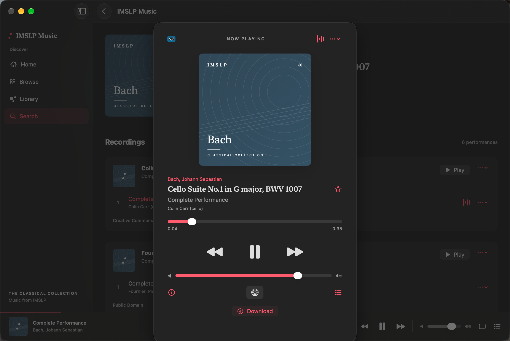
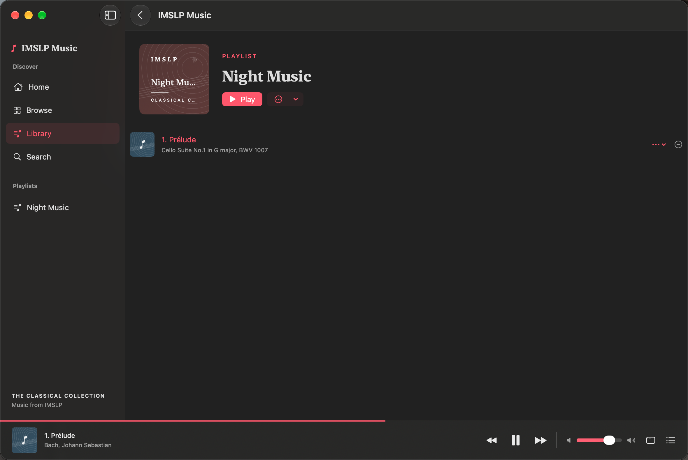
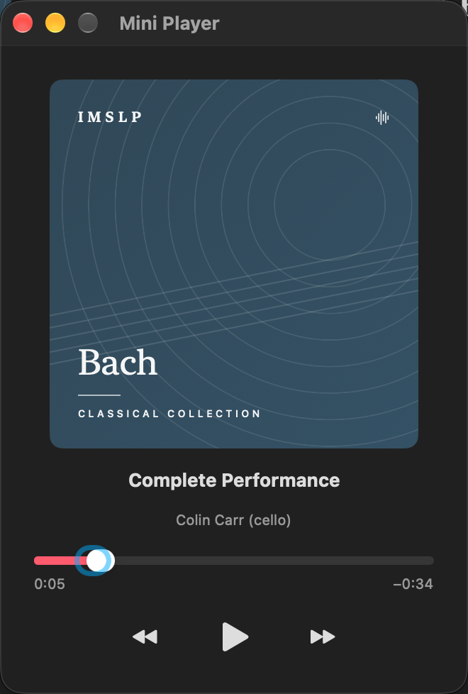

# IMSLP Music

A native classical music app for Mac, iPhone, and iPad. It uses SwiftUI, AppKit/UIKit, AVFoundation, MediaPlayer, and SwiftData. There is no web app wrapper or custom server.

The interface follows Apple Music Classical's composer, work, recording, and movement model. It has its own name and icon. Exact pixel and interaction parity with Apple's app is not claimed.



## Screenshots

Library and playlist view:



Separate Mac mini player:



## Install

Download the Mac DMG or ZIP from [Releases](../../releases). Open the DMG and drag IMSLP Music to Applications. For the ZIP, extract it and move the app to Applications.

The Mac export uses a local ad-hoc signature. It has no Developer ID signature or Apple notarization. macOS can block it. It is not a verified public installer. You can build the app from source with Xcode instead.

iPhone and iPad source targets are included. No IPA is supplied. Physical devices need your own signing team.

## Build and run

Open `IMSLPMusic.xcodeproj` in Xcode. Select **IMSLPMusicMac** and run on My Mac, or select **IMSLPMusicMobile** and an iPhone/iPad simulator. Physical devices need your signing team.

Minimum systems: macOS 15, iOS 18, iPadOS 18. The checked-in project can be opened without XcodeGen. After a project configuration change, run `xcodegen generate`.

```sh
xcodebuild -project IMSLPMusic.xcodeproj -scheme IMSLPMusicMac \
  -configuration Debug -derivedDataPath build/mac build
open 'build/mac/Build/Products/Debug/IMSLP Music.app'
```

## Features

- Composer and work search, composer browsing, recording groups, and source artwork.
- Streaming, seek, previous/next, shuffle, repeat, editable queue, system media commands, and mobile background audio.
- Local favorites, saved tracks, playlists, listening history, and restored queue without autoplay.
- Downloads with progress, cancellation, retry, audio validation, and offline playback.
- Separate Remove Download and Remove from Library actions.
- Full player, AirPlay output control, and a separate Mac mini player.

Mac shortcuts: Command-F opens search; Space toggles playback; Command-Left/Right changes tracks; Option-Command-U opens the queue. Open the mini player from the player bar.

Each device has its own library. iCloud sync, member login, scores, editorial content, and store publication are not included.

## Source integration

`IMSLPClient` reads the public MediaWiki search, revision, parse, and image APIs. The IMSLP worklist API provides the people directory. `WikiParser` reads balanced `imslpaudio` templates and preserves numbered file order. It keeps synthesized audio separate and excludes scores and videos.

The file-info address can return an HTML access page. Audio is resolved from the public player configuration in the rendered work response. The app does not execute scripts from that response. Recordings without a public player link show Open IMSLP and any source region label. The website may require a bot check. The app does not bypass it. MIDI is listed separately and is not synthesized by this app.

Source data is incomplete and changes over time. Some works have scores but no audio. Album images and performer details are shown only when the source supplies them. License text and original source links remain available with each recording.

## Verification

See [acceptance cases](Docs/Acceptance.md) and [verification results](Docs/Verification.md). Failure cases and E2E test scenarios were written before implementation. No unit tests are used.

Run `Scripts/test.sh mac`, `Scripts/test.sh iphone`, or `Scripts/test.sh ipad` to save a dated result bundle, log, and screenshot export. The equivalent Xcode commands are:

For the mobile scripts, first create simulators named `IMSLP iPhone` and `IMSLP iPad` in Xcode's Devices and Simulators window. Choose an installed iOS runtime at version 18 or later.

```sh
xcodebuild -project IMSLPMusic.xcodeproj -scheme IMSLPMusicMac \
  -derivedDataPath build/mac -resultBundlePath Artifacts/mac-e2e.xcresult test

xcodebuild -project IMSLPMusic.xcodeproj -scheme IMSLPMusicMobile \
  -destination 'platform=iOS Simulator,name=IMSLP iPhone' \
  -derivedDataPath build/mobile -resultBundlePath Artifacts/iphone-e2e.xcresult test
```

Use a new result-bundle path for each run. Run UI tests on one platform at a time. Tests use an isolated library and bundled source responses. Fixture audio is an original test tone, not a commercial recording. The parser and player are the production implementations. The fixture path uses a local file for download validation, so it does not prove network transfer behavior.

The two live checks use the production client and a public IMSLP recording:

```sh
swiftc -parse-as-library Sources/Core/Models.swift Sources/Core/WikiParser.swift \
  Sources/Core/IMSLPClient.swift Scripts/LiveCatalogCheck.swift -o Artifacts/live-catalog-check
Artifacts/live-catalog-check
swiftc -parse-as-library Scripts/LiveAudioCheck.swift -o Artifacts/live-audio-check
Artifacts/live-audio-check
```

The audio check is muted. It streams, seeks, downloads the file, and compares its duration. See `Tests/Fixtures/README.md` for source attribution.

## Data and privacy

The app stores the library, queue, history, and downloaded audio on the device. It sends search terms and content requests to IMSLP and its media hosts. There is no app account, cloud sync, custom server, or added analytics service. Source links open in the default browser. Each recording keeps its source and license details.

Build folders, user libraries, downloaded music, test logs, and local test result bundles are excluded from this repository. The preview uses public catalog metadata and a test tone.

## Release limits

Mac and iPhone core E2E checks passed during development. iPad and largest-text checks remain incomplete due to simulator test service failures. Physical devices, external AirPlay hardware, and a full spoken VoiceOver audit have not been verified. See [verification](Docs/Verification.md) for details. The older minimum OS versions were checked by the compiler, not by runtime tests.

The Release build excludes test responses and the test tone. Debug builds include them for repeatable E2E checks.

## License

App source uses the [MIT License](LICENSE). Source fixtures and recordings retain their separate licenses.

## Acknowledgments

IMSLP supplies the catalog and recording metadata. Recordings retain their own licenses and access conditions. Saved source fixtures use CC BY-SA 4.0; see [fixture attribution](Tests/Fixtures/README.md). This project is not affiliated with IMSLP or Apple. Apple Music Classical is the interface reference.
